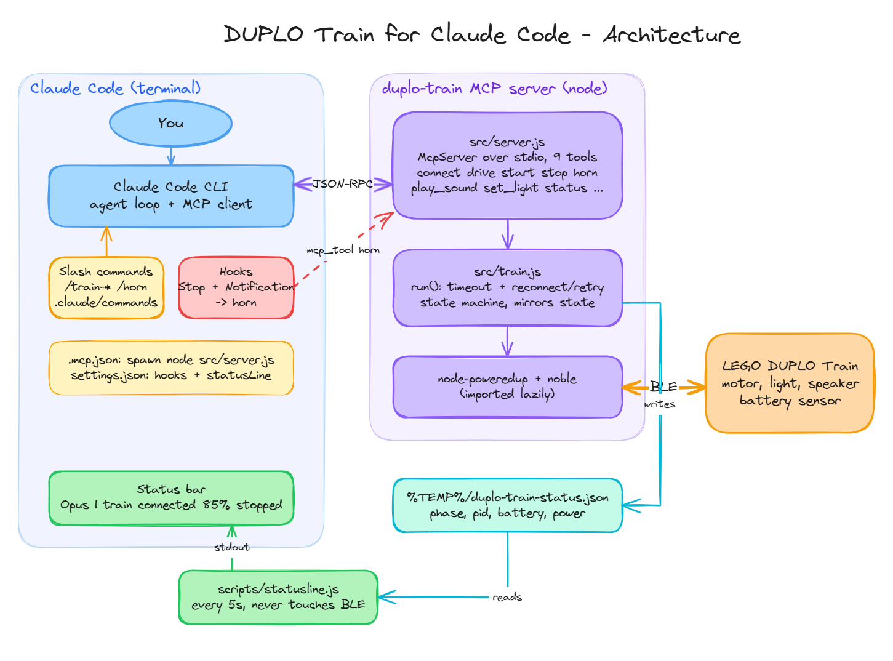

# agent-lego-agent-mcp

Drive a **LEGO DUPLO train** (Train Base hub from the DUPLO Push & Go / Steam / Cargo sets, e.g. 10874, 10875, 10427, 10428) from **Claude Code**.
It works through an MCP server built on [node-poweredup](https://github.com/nathankellenicky/node-poweredup) over Bluetooth Low Energy.

```
Claude Code ──stdio/MCP──> src/server.js ──> src/train.js ──node-poweredup──BLE──> DUPLO train
```

> **Why it's built this way:** see [ADR 0001](docs/adr/0001-claude-code-drives-duplo-train-via-mcp.md).
> **Diagram:** [`docs/architecture.excalidraw`](docs/architecture.excalidraw). Open it at <https://excalidraw.com> or with the VS Code Excalidraw extension.

## Architecture

<!-- TODO: export docs/architecture.excalidraw as SVG (Excalidraw: Menu → Export image → SVG, "Embed scene" on) and save it as docs/architecture.svg -->


*Source: [`docs/architecture.excalidraw`](docs/architecture.excalidraw). Edit it there and re-export the SVG.*

The design rests on these choices:

1. **One process owns the Bluetooth link.** Claude Code spawns `src/server.js` from `.mcp.json`, and it lives as long as the session. The DUPLO hub accepts only **one** BLE connection, so the model, the slash commands and the hooks all go through this one process. None of them connect on their own.
2. **The MCP layer is thin and the controller holds the logic.**
   - `src/server.js` only declares the tools (zod schemas) and turns results or errors into MCP responses.
   - `src/train.js` holds the connection state machine (`disconnected → scanning → connected → reconnecting / error`).
   - Every BLE command goes through `run()`, which adds a timeout, drops a dead link, re-scans for the same train by UUID and retries the command once.
3. **stdout is sacred.** Stdio carries JSON-RPC, so the server sends `console.log` to stderr before anything else loads.
4. **Bluetooth loads lazily.** `node-poweredup` is imported on first use. The server starts and passes its tests on machines with no Bluetooth (CI).
5. **Hooks reuse the live connection.** The `Stop` and `Notification` hooks use the `mcp_tool` hook type to call `horn` inside the already-connected server. With `onlyIfConnected: true`, a disconnected train costs nothing: no scan, no wait.
6. **The status line goes through a file, not Bluetooth.** The server writes its state to `%TEMP%/duplo-train-status.json` (atomic write; `DUPLO_STATE_FILE` overrides the path). `scripts/statusline.js` reads it every 5 s, checks that the server pid is alive and prints one line. It can't hang and never competes for the hub.
7. **The lifecycle is tied to the session.** When Claude Code exits (stdin closes, SIGINT or SIGTERM), the server stops the motor, disconnects and marks the state `offline`.

### What happens when you type `/horn`

1. Claude Code expands `.claude/commands/horn.md`, and the model calls the MCP tool `mcp__duplo-train__horn`.
2. `src/server.js` calls `train.horn()`. `run()` connects first if needed (scan, attach motor, speaker and LED, then a 500 ms settle delay).
3. `node-poweredup` writes the "play sound" command over BLE, with a 5 s timeout. On failure it reconnects and retries once.
4. `src/train.js` publishes the new state to the JSON file, and the status line shows it on its next refresh.

## 1. Requirements

| | |
|---|---|
| OS | Windows 10/11 (tested on Windows 11). macOS and Linux also work with node-poweredup. |
| Bluetooth | A **Bluetooth LE (4.0+)** adapter. Built-in laptop Bluetooth is fine. |
| Node.js | **20 or newer** (tested on 24). |
| Claude Code | `npm install -g @anthropic-ai/claude-code`, then `claude` and `/login` |
| Train | DUPLO train with fresh AA batteries |

## 2. Install

```powershell
git clone https://github.com/mjendza/agent-lego-agent-mcp.git
cd agent-lego-agent-mcp
npm install
npm run check:ble      # should print: Bluetooth state: poweredOn / OK
```

npm 11 may warn that `@stoprocent/noble` has install scripts that were not approved.
You can ignore this: the package ships a prebuilt Windows binary (`prebuilds/win32-x64`), so nothing has to compile.
If `check:ble` prints `poweredOn`, the Bluetooth stack works.

## 3. Bluetooth: connecting the train

You don't pair the train in Windows. The library finds it over BLE and connects to it directly.

1. **Turn on Bluetooth** in Windows: *Settings → Bluetooth & devices → Bluetooth: On*.
2. **Do NOT pair the train** in Windows Settings. If you already did, open *Bluetooth & devices*, find the "Train Base" device and click **Remove device**. A paired train often won't connect.
3. **Close the LEGO DUPLO Connected Train app** on any phone or tablet nearby. The hub accepts only **one** connection at a time.
4. **Wake the train:** press the **green button** on top of the locomotive. The light on the train starts **blinking**, which means it is waiting for a connection.
5. Connect from Claude Code with `/train-connect`. Any other command also connects automatically. When it connects, the light stops blinking.
6. The train powers off by itself after a few minutes of inactivity. When that happens, press the button again.

To test the hardware without Claude:

```powershell
npm run scan     # find + connect + print name/battery, then disconnect
npm run smoke    # connect, horn, green light, drive 2 s, brake, disconnect
```

## 4. Use from Claude Code

```powershell
cd agent-lego-agent-mcp
claude
```

The project includes these config files:

- `.mcp.json` registers the MCP server `duplo-train` (`node src/server.js`).
- `.claude/settings.json` pre-approves that server (`enabledMcpjsonServers`) and allows its tools (`mcp__duplo-train`), so you don't get a prompt on every horn.
  On the first start, Claude Code may still ask you to trust the folder or approve the project MCP server. Answer yes.
- `.claude/commands/*.md` defines the slash commands below.

Check that the server is running with `/mcp`. `duplo-train` should show as *connected* with 9 tools.

### Slash commands

| Command | What it does | MCP tool |
|---|---|---|
| `/train-connect [timeout]` | Tells you to press the button, then scans and connects | `connect` |
| `/horn` | Toot toot! | `horn` |
| `/train-start [speed] [forward\|backward]` | Start or change speed (0–100, default 50). Takes `slow` or `fast` too | `start` |
| `/train-stop [coast]` | Brake (default) or coast to a stop | `stop` |
| `/train-status` | Connected?, battery %, current power | `status` |
| `/train-disconnect` | Stop and disconnect | `disconnect` |

### Horn hook: the train honks when Claude needs you

`.claude/settings.json` sets up two hooks, `Stop` (Claude finished its turn) and `Notification` (Claude is waiting for a permission or your input).
Both call the MCP tool `horn` with `onlyIfConnected: true`. They use the `mcp_tool` hook type, so the call goes through the MCP server that already holds the Bluetooth connection.

- The horn only sounds after the train is connected (`/train-connect` once per session). When the train isn't connected, the hook does nothing and doesn't scan, so Claude never waits on it.
- To turn the hooks off, delete the `hooks` block from `.claude/settings.json`, or review them in `/hooks`.

### Auto-connect when Claude Code starts

`.mcp.json` sets `DUPLO_AUTOCONNECT=60`, so the MCP server starts scanning for the train as soon as Claude Code launches. You don't need to run `/train-connect`. Press the green button within 60 s and the status line goes from `scanning… press the green button` to `connected`.

- The scan runs in the background, so Claude Code starts right away either way.
- If no train is found in time, the status line says so. Press the button and run `/train-connect` or any train command.
- Set the value to a number of seconds (5–120), `1`/`true` for 60 s, or `0`/remove it to turn auto-connect off.

### Status line: train connection at a glance

`.claude/settings.json` also sets a `statusLine` (`node scripts/statusline.js`), which shows for example:

```
Opus 5.5 | 🚂 connected · 🔋100% · ▶ 40%
Opus 5.5 | 🚂 link lost, reconnecting…
Opus 5.5 | 🚂 not connected (/train-connect)
```

The MCP server writes its state to `%TEMP%\duplo-train-status.json` (override with `DUPLO_STATE_FILE`). The script only reads that file, so it never touches Bluetooth. If the server process is gone, the line shows `server offline`.
`refreshInterval: 5` re-runs the script every 5 s, so a lost link shows up even while you're idle.
The command path is relative, so launch `claude` from the repo root. The status line also stays blank until you accept the folder-trust prompt.
Two Claude Code sessions share one state file, so the most recent server's state wins. That's fine with a single train.
A project `statusLine` replaces your own status line from `~/.claude/settings.json`. Remove the block if you'd rather keep yours.

### Reliability: timeouts, reconnect, retry

- Every Bluetooth command has a 5 s timeout, so a dead link can't hang Claude.
- If a command fails, the server drops the stale connection, re-scans for **the same train** (up to 20 s) and retries the command once.
- If the train drops the link unexpectedly, the server re-scans once in the background. The hub goes back to blinking when it loses the link, so it usually reconnects with no button press.
- If connecting fails halfway (for example the motor never attaches), the server releases the hub. Otherwise the train would stay "connected" and invisible to the next scan.
- Auto-reconnect can't wake a train that has **powered off** (after a few idle minutes). Press the green button and run any command.
- `stop` and the horn hook never reconnect, so they stay fast.

### Natural language

The tools are available to Claude directly, so you can also just ask:

> "Connect to the train, blow the horn twice, drive forward at 40 for 5 seconds, then make the water refill sound and turn the light blue."

### MCP tools

| Tool | Arguments |
|---|---|
| `connect` | `timeoutSeconds` (5–120, default 30), `name` (optional hub name) |
| `disconnect` | – |
| `status` | – |
| `horn` | `onlyIfConnected` (default `false`; hooks set `true` to skip scanning) |
| `play_sound` | `sound`: `HORN`, `BRAKE`, `STATION_DEPARTURE`, `WATER_REFILL`, `STEAM` |
| `start` | `speed` 0–100, `direction` `forward`/`backward` |
| `drive` | `speed`, `direction`, `seconds` (≤ 60), then brakes |
| `stop` | `brake` (default `true`) |
| `set_light` | `color`: `BLACK, PINK, PURPLE, BLUE, LIGHT_BLUE, CYAN, GREEN, YELLOW, ORANGE, RED, WHITE, NONE` |

All action tools connect automatically if the train isn't connected yet.
When Claude Code exits, the server stops the motor and disconnects.

## 5. Troubleshooting

| Symptom | Fix |
|---|---|
| `No DUPLO train found within 30 s` | Press the green button (the light must blink). Unpair the train in Windows. Close the LEGO app. Change batteries. Move closer. |
| `check:ble` never reaches `poweredOn` | Bluetooth is off, or the adapter doesn't support BLE. Toggle Bluetooth off and on, or use a BLE 4.0+ USB dongle. |
| Train doesn't move at low speed | DUPLO motors need about 20–30 % power to start. |
| First horn is silent | Run it again. The server waits 500 ms after connecting, but the hub sometimes drops the first sound. |
| `/mcp` shows the server failed | Run `node src/server.js` in a terminal. It should print `MCP server ready on stdio` to stderr. Press Ctrl+C to quit. |
| Need more detail | `.mcp.json` sets `DEBUG=poweredup`. Logs appear in Claude Code's MCP logs (`claude --debug`). For scripts, run `$env:DEBUG="poweredup*"; npm run smoke`. |
| Debug the MCP server by hand | `npm run inspector` opens the MCP Inspector in a browser. |

## Development and CI

```powershell
npm run build   # syntax-check all sources
npm test        # hardware-free tests (MCP server over stdio + config validation)
```

GitHub Actions (`.github/workflows/ci.yml`) runs `npm ci`, then `build`, then `test`, then `npm audit` on every pull request to `main` and every push to `main`.
It tests Ubuntu and Windows on Node 20 and 24.
CI has no train or Bluetooth, so the hardware tests (`npm run smoke`) stay manual.

## Project layout

```
.mcp.json                  MCP server registration for Claude Code
.claude/settings.json      approves the server + allows its tools
.claude/commands/          /train-connect /horn /train-start /train-stop /train-status /train-disconnect
src/server.js              MCP stdio server (tools)
src/train.js               train controller on top of node-poweredup
scripts/check-ble.js       is Bluetooth LE usable from Node?
scripts/smoke.js           hardware test without Claude
scripts/statusline.js      Claude Code status line (reads the server's state file)
docs/adr/                  architecture decision records
docs/architecture.excalidraw  architecture diagram
```
